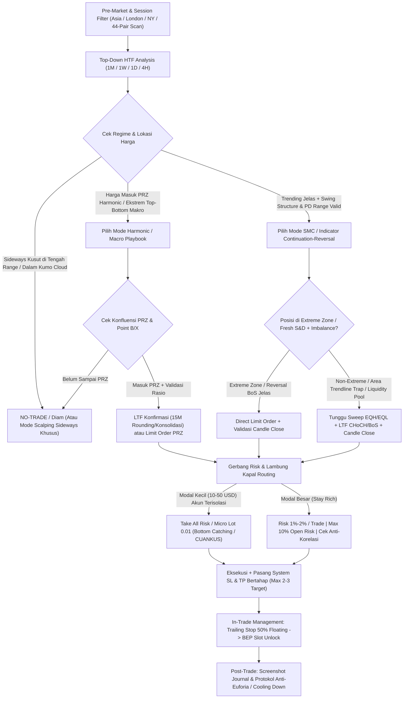

# ARIST MD (MANCING DOLLAR) — REVERSE-ENGINEERED TRADING PLAYBOOK

> **Cakupan Riset:** Disusun dari hasil menonton & ekstraksi multimodal audio-visual atas **199 video (100% cakupan)** — terdiri dari **34 video reguler `@Mancing_Dollar`** (13,10 jam), **31 video kolaborasi/podcast eksternal terverifikasi** (23,12 jam), dan **134 YouTube Shorts**.  
> **Dokumen Pendukung:** [EVIDENCE_MATRIX.md](./EVIDENCE_MATRIX.md) | [VIDEO_INVENTORY_AND_INDEX.md](./VIDEO_INVENTORY_AND_INDEX.md)

---

## 1. Executive Reverse-Engineering Summary: DNA Asli Arist MD & Peta Ekosistem

### 1.1 Profil Terverifikasi Arist MD
* **Identitas & Lisensi:** **Arist MD / Arist Wang** (`@arist.wang`), lulusan Sarjana Perikanan (**S.Pi**), **Certified Technical Analyst (CTA)**, dan **Wakil Penasihat Berjangka (WPA)** resmi berlisensi Bappebti di bawah **Ruang Investasi Indonesia** `[rh3plkdMQ-M]`, `[PvlswFHD2ww]`, `[sjLP7c1tNE4 @ 00:51]`. Founder komunitas edukasi **Mancing Dollar** serta Co-Founder **Posko Trading** `[sjLP7c1tNE4 @ 00:51]`.
* **Rekam Jejak & Pengujian Kuantitatif:** Sistem dibangun pasca-kehancuran portofolio dari Rp900 Juta -> Rp14 Miliar (`~$1 Juta`) -> Rp300 Juta -> nol (termasuk catatan rugi Rp16 Miliar akibat leverage 4x & ego) `[PiISTaVFezY @ 05:32]`, `[WAOZM1Jg0bQ]`, `[upV2nEORCR8 @ 64:30]`. Setiap metode baru wajib melewati minimal **200–300x backtest** (`[WAOZM1Jg0bQ @ 12:25]`, `[fT7FARKKGWk @ 19:00]`), dengan klaim log prediksi eksternal mencapai **198 dari 203 kejadian** `[HpT5oNnVn30 @ 13:05]` / **215 dari 220 percobaan** `[1_x_Xu68mlg @ 05:31]`.

### 1.2 Pemisahan Tegas 4 Lapisan Ekosistem Mancing Dollar
Salah satu temuan paling krusial dari menonton seluruh 199 video adalah bahwa **tidak semua metode di channel Mancing Dollar dan Posko Trading merupakan gaya pribadi yang sama**. Playbook ini memisahkan 4 lapisan atribusi secara ketat:

| Lapisan Ekosistem | Tokoh Utama | Spesialisasi & Gaya Asli | Video Kunci |
|---|---|---|---|
| **Lapisan 1: `[Arist MD Core]`** | **Arist MD / Arist Wang** (Ko Aris / Bro Aris) | **DNA Reversal ("Cari Pucuk & Lembah")**, Metode **HIT (High Intensity Target)**, **Harmonic Pattern & Stingray PRZ**, Prediksi Anomali Makro/Crash (Intermarket US10Y/BOJ/K-Shape), Scalping Sideways "Nyopet" + Multi-Indikator, Arsitektur Multi-Akun **Lambung Kapal** (11–29 akun), dan kurikulum inti Market Structure / Wyckoff / S&D / Imbalance / Liquidity. | `[WAOZM1Jg0bQ]`, `[C9zlS7yMvMg]`, `[oz52BAFzPJg]`, `[VpacB5MdAEU]`, `[o_xdHhmTiEU]`, `[RKswvZ4Wv3M]`, `[owyIG_0TYRM]`, `[ERTLpTRrRf4]`, `[wRq8mXtblA4]` |
| **Lapisan 2: `[Co-Mentor: Ragnaray]`** | **Ragnaray** (Bang Ray / Bang Rey) | **Master Harmonic Pattern** & partner strategis Arist MD. Co-creator **Stingray Pattern** (bersama **Pak Edi** & **Arist MD**) dari backtest ~1.500 pola. Fokus presisi rasio XABCD, validasi **Point B Trigger Dump/Pump**, serta TP Fibonacci bertahap A–D / C–D. | `[nI3jBKf5oq4]`, `[bql0VbOCc-0]`, `[JswbZ3c5zq4]`, `[9Qa4Le_jsxk]`, `[sjLP7c1tNE4]` |
| **Lapisan 3: `[Co-Mentor: Franz & Danial]`** | **Franz (`@franzz_md`)** & **Danial** | **Franz:** Spesialis **Naked-Chart XAUUSD Scalping (0 Indikator)** pada M15->M5->M1, 3-TF alignment, pola "Kocokan + Last Push", dan aturan keras *"Scalping minus jangan diubah jadi swing"*. **Danial:** Scalping Harmonic Bat/Gartley M15->M5->M1 dengan ritme **Senin Depo, Jumat WD**. | **Franz:** `[5AScuHwrZVc]`, `[6NfDII3qpPI]`, `[JbKfARTc9TU]`, `[iwUA0Z4W17U]`, `[wZiTtPh7vho]`, `[rZC0YrjKSkc]`, `[cjESyO-ACgs]`, `[nYMDTgAhPBg]` <br>**Danial:** `[85gggZscS0A]` |
| **Lapisan 4: `[Guest Case Studies]`** | **Pak Mustofa**, **Bu Arlind**, **Denny Santoso** | **Pak Mustofa:** Scalping M15/M3/M1 EMA(5,9,21) + Fibo 0.618 menuju PRZ magnet. **Bu Arlind:** M1/M5 Mandiri Scalping di PRZ dengan 4 indikator + reset saldo harian Rp500rb–Rp1jt. **Denny Santoso:** NLP / BrainBoost audio conditioning untuk Fear & Greed. | `[nPW34qQZHYI]`, `[XX3rM7wJceM]`, `[PiISTaVFezY]` |

### 1.3 Filosofi Inti & Aksioma Sistem
1. **Aksioma *Technical-First & Delayed Fundamental*:** `Price Action (Chart) -> Market Event -> Fundamental News (Delayed Narrative)` `[o_xdHhmTiEU @ 06:08]`, `[1_x_Xu68mlg @ 14:49]`, `[fN__ipoexcg @ 07:11]`. Berita dianggap *noise* atau penjelasan retrospektif yang muncul setelah *Big Money* mengeksekusi posisinya.
2. **Ontologi *"Halte vs Terminal"* (`[owyIG_0TYRM @ 28:09]`):**
   * **Indikator Halte** (MA, Bollinger Bands, Ichimoku, RSI, MACD) hanya menunjukkan titik pemberhentian sementara (*pullback*) di tengah tren — gagal mendeteksi ujung pembalikan absolut.
   * **Indikator Terminal** (**Harmonic Patterns & PRZ**) memetakan titik akhir absolut (*Top / Bottom*) di mana tren berhenti dan berbalik arah.
3. **Arsitektur 3-Mode Operasional:**
   * **Mode 1 (`0 Indikator`):** Pure Price Action / SMC (Struktur, S&D, Imbalance, Liquidity, Wyckoff, serta Naked-Chart Scalping ala Franz).
   * **Mode 2 (`Clean Chart + XABCD + Fibo`):** Harmonic & Stingray PRZ / Metode HIT (DNA utama Arist MD & Ragnaray untuk Swing & Makro).
   * **Mode 3 (`Indicator-Assisted`):** 4MA / MA Ribbon + BB(20,2) + Ichimoku(9,26,52,26) + RSI(14) + MACD(12,26,9) / Stochastic untuk Trend "Halte" dan Scalping Sideways.

---

## 2. System Architecture & Master Decision Flowchart



### Tabel Ringkasan Perbandingan 4 Mode Operasional

| Dimensi | Mode A: SMC Continuation | Mode B: Reversal & Harmonic PRZ | Mode C1: Arist Scalping | Mode C2: Franz Naked Scalping *(Co-Mentor)* |
|---|---|---|---|---|
| **Timeframe (Top-Down)** | `4H/1H` -> `30M/15M` -> `5M` | `1W/1D/8H/4H` -> `1H/15M` (atau `6H/5M` SMC) | `1H/4H` -> `M15` -> `M5/M1` | `1D/4H/1H` -> `M15` -> `M5` -> `M1/15s` |
| **Alat Utama** | HH/HL/LH/LL, S&D, Imbalance, EQL/EQH | XABCD (Stingray, Bat, Butterfly, Crab, Shark) & PRZ; atau BoS+Imbalance+S&D | (1) RSI OB/OS + BB + MA5 + Chart Pattern; (2) MA 5/50/100/200 + BB(20,2) + Fibo | Naked Chart murni (`0` indikator), S/R, Candle Psychology, "Kocokan + Last Push" |
| **Konfirmasi Entry** | Direct Limit (Extreme) atau LTF CHoCH (Non-Extreme) | Limit di PRZ / S&D BoS, atau tunggu 15M rounding/konsolidasi | Candle rejection di Fibo `0.5–0.618` + MA/BB; atau layering di batas sideways | **Wajib 3 TF searah** (`15M/5M/1M`), masuk 1–2 menit jelang candle close |
| **Target R:R** | Min `1:3` (Confirmation hingga `1:8.5–1:10.6`) | Min `1:2` (TP1 Harmonic) s.d. `1:4–1:12` | TP Fibo `0.236/0.382` (Nyopet) atau Middle Band / Fibo `0.5–0.618` | Target cepat `5 poin` XAUUSD / Rp1–3jt per lot (1–2 candle) |
| **Kapan Dipakai** | Pasar trending sehat dengan Imbalance | Puncak/dasar ekstrem & akhir tren | (1) Sideways pasca-impulsif; (2) Pullback LTF | Konsolidasi pasca-gerak ekstrem XAUUSD di sesi aktif |

---

## 3. Pillar 1: Top-Down Market Structure & Regime Engine

### 3.1 Fondasi Struktur Murni (`[Arist MD Core]`)
* **Logika BFI & *Breathing Pattern*:** Pergerakan harga digerakkan oleh institusi besar (*Banks & Financial Institutions* / BFI) yang memecah order melalui fase konsolidasi `[C9zlS7yMvMg @ 02:08, 21:10]`, `[6NfDII3qpPI @ 03:03]`. Harga bergerak dalam siklus dorongan (*impulsive*) lalu napas (*retracement*) `[C9zlS7yMvMg @ 05:28]`:
  * **Uptrend:** Membentuk *Higher High (HH)* dan menjaga *Higher Low (HL)* `[C9zlS7yMvMg @ 11:05]`.
  * **Downtrend:** Membentuk *Lower Low (LL)* dan menjaga *Lower High (LH)* `[C9zlS7yMvMg @ 15:38]`.
* **Syarat Validitas Titik Swing:** Sebuah High/Low baru hanya sah menjadi titik struktur bila diikuti minimal **1 hingga 2 candle berlawanan arah** (*retracement*) `[C9zlS7yMvMg @ 17:21, 30:32]`.
* **Aturan *Wick Break* vs *Body Close*:**
  * Dalam pembacaan struktur murni pribadi Arist, **sumbu (*wick*) yang menembus level struktur sudah dihitung Break** (`C9zlS7yMvMg @ 13:08`, `EHHIbaRK7B8 @ 00:50`) karena level kuat tidak seharusnya mampu disentuh pun.
  * Dalam modul validasi *Liquidity Sweep* & *Wyckoff*, **BOS hanya sah dengan *Body Candle Close***; penembusan berupa *wick* saja diklasifikasikan sebagai *Price Rejection / Sweep* (`BXxdVGV1sUY @ 08:03`, `KFl5s7u-nW4 @ 18:25`).
  * *Aturan Emas Konsistensi:* Pilih **satu** definisi (*Wick* atau *Body Close*) sesuai modul strategi yang dipakai dan terapkan secara konsisten tanpa berubah-ubah `[oz52BAFzPJg @ 36:00]`.

### 3.2 Strong (Protected) vs Weak High/Low (`[oz52BAFzPJg @ 01:20–03:50]`)
* **Strong Low (Protected Low):** HL yang berhasil mendorong harga menembus High sebelumnya (membentuk HH baru). Dilindungi BFI sehingga tidak mudah ditembus.
* **Strong High (Protected High):** LH yang berhasil menekan harga menembus Low sebelumnya (membentuk LL baru). Dilindungi order jual BFI.
* **Weak High / Weak Low:** Titik HH atau LL yang tidak mampu mematahkan struktur lawan — berstatus sebagai **target likuiditas** yang rentan disapu.
* **Aturan Arah Trade:** Selalu trading **menjauhi Strong Level menuju Weak Level** (Buy dari Strong Low ke Weak High; Sell dari Strong High ke Weak Low) `[oz52BAFzPJg @ 02:12]`. Jika *Strong Low* pertama ternyata jebol, abaikan level-level minor di bawahnya karena pasar akan menyapu seluruh likuiditas di bawahnya `[oz52BAFzPJg @ 06:05]`.

### 3.3 Hierarki Timeframe, Swing vs Substructure & Sifat Fraktal
* **Hierarki 3-Lapis (`[oz52BAFzPJg @ 08:30–09:28]`):** **Major Structure** di `4H / Daily` -> **Minor / Internal Structure (Substructure)** di `1H / 15M` -> **Entry / Execution** di `5M / 1M`. Jangan meloncat terlalu ekstrem (misal langsung dari `4H` ke `5M` tanpa membaca `1H` perantara) `[ecMB7sBJhPc @ 23:15]`.
* **Swing Structure vs Substructure (`[itdyXYoNVBc @ 00:39–03:16]`):** *Swing Trader* mengikuti arah impuls utama HTF (*Swing Structure*). *Day Trader* wajib menghormati arah koreksi internal (*Substructure*) di `1H/15M` dan dilarang memaksa counter-entry sebelum harga menyentuh zona S&D HTF.

### 3.4 Premium & Discount (PD Range) & 3 Formasi Struktur (`[oz52BAFzPJg @ 21:48–41:48]`)
* **Setting Fibonacci PD Range:** Hanya gunakan 3 level: **`0`**, **`0.5` (Equilibrium)**, dan **`1`**.
  * **Premium (`> 0.5 – 1.0`):** Zona harga mahal -> **hanya cari setup Sell**.
  * **Discount (`0.0 – < 0.5`):** Zona harga murah -> **hanya cari setup Buy** `[oz52BAFzPJg @ 24:30–24:35]`.
* **3 Formasi Perubahan Struktur:**
  1. **MSS (Market Structure Shift):** Harga gagal membuat HH/LL baru -> sinyal *peringatan dini* kelelahan tren (belum konfirmasi entry penuh) `[oz52BAFzPJg @ 30:50]`, `[C8PFBrQeY60 @ 00:25]`.
  2. **TC (Trend Change):** Penembusan *Major HL* atau *Major LH* terakhir (membutuhkan validasi 2 titik struktur baru). **Syarat Wajib Lokasi:** TC hanya sah jika terjadi di dalam **Zona S&D HTF** atau **area ekstrem PD Range** — dilarang keras entry bila TC muncul di tengah chart kosong `[oz52BAFzPJg @ 35:07, 40:32–41:00]`, `[4wOUywD-zqM @ 00:33]`.
  3. **SB (Structure Break / BOS):** Penembusan HH/LL searah tren yang berjalan untuk konfirmasi *continuation* `[oz52BAFzPJg @ 36:53]`, `[RUPVoBc55OE @ 00:07]`.

### 3.5 Simplified Wyckoff & Regime Filter ("Kapan Harus Diam")
* **4 Fase Wyckoff (`[KFl5s7u-nW4 @ 05:54–15:40]`):** *Accumulation* (sideways bawah -> *Spring* sweep low -> *SOS* breakout -> pullback Demand) -> *Markup* -> *Distribution* (sideways atas -> *Upthrust* sweep high -> *SOW* breakdown -> pullback Supply) -> *Markdown*. Arist menolak hafalan label kompleks (PS/SC/AR/ST) karena membuat trader terlambat bertindak `[KFl5s7u-nW4 @ 10:15]`.
* **Regime Filter Sideways (`[owyIG_0TYRM @ 21:12, 22:24]`, `[Zritj0nmL9U @ 00:27]`, `[C9zlS7yMvMg @ 24:28]`):** Apabila HTF `4H` sedang *ranging* penuh sumbu tajam, harga menabrak kusut ke-4 garis MA, atau harga masuk ke dalam awan *Ichimoku Kumo Cloud*, **MATIKAN semua alat trend-following dan DIAM (No-Trade)** — kecuali menjalankan mode *Scalping Sideways* khusus pada M15/M5.

---

## 4. Pillar 2: Key Levels, Zones & Confluence Arsenal

### 4.1 Harmonic Patterns & Proprietary Stingray PRZ (`[Arist MD Core]` & `[Co-Mentor: Ragnaray]`)
Harmonic Pattern adalah sistem geometri utama untuk memetakan **PRZ (Potential Reversal Zone)** beserta titik **Invalidasi** yang terukur secara matematis:

| Pola Harmonic | Rasio Point B (vs XA) | Rasio Point C (vs AB) | Rasio Point D / PRZ | Invalidasi / SL | Target TP (Fibo A–D / C–D) |
|---|---|---|---|---|---|
| **Stingray Pattern** *(Proprietary MD)* | **`0.382 – 0.50`** | Validasi internal tim MD | **Extension `1.272` dari XA** | **Point X** (jika jebol -> Plan B) | Tarikan Fibo **A–D** / **C–D** (TP1/TP2/TP3) `[nI3jBKf5oq4 @ 12:56–13:36]` |
| **Bat Pattern** | `~0.382 – 0.50` | Standar XABCD | **Retracement `0.886` dari XA** | Luar **Point X** / PRZ | Fibo A–D / C–D `[85gggZscS0A @ 19:25]`, `[hwgR9GhR86A @ 00:46]` |
| **Butterfly Pattern** | **`0.786`** | **`0.382 – 0.886`** | **Extension `1.272` dari XA** | Luar PRZ / Point X | Expect Target TP1/TP2/TP3 `[nI3jBKf5oq4 @ 11:25]`, `[tgIcHhGh_78 @ 02:39]` |
| **Crab / Deep Crab** | Standar Crab | Standar XABCD | **Extension `1.618`** *(teramati `0.872 / 1.272 / 1.618`)* | Luar PRZ | Expect Target PRZ lawan `[WAOZM1Jg0bQ @ 13:10]`, `[cfw_O5dG4Bk @ 19:52]` |
| **Shark Pattern** | — | — | **`0.886 – 1.13` dari X ke C** | Luar PRZ (`>1.13`) | Fibo **C–D**: **TP1 `0.382`**, **TP2 `0.50`**, **TP3 `0.618`** `[bql0VbOCc-0 @ 21:00–23:32]` |
| **ABCD Pattern** | — | Ukur C ke D | Titik **D** | Tembus **Point C** | Fibo **`0.618` dari C ke D** `[ERTLpTRrRf4 @ 14:04]`, `[cfw_O5dG4Bk @ 16:01]` |

* **Mekanisme Cascade Plan A -> Plan B (`[hwgR9GhR86A @ 02:44, 07:03]`):** Jika Point X dari pola XABCD pertama (mis. Bat `0.886`) tertembus (*breakdown*), pola pertama batal dan sistem otomatis berpindah ke **Plan B** menunggu PRZ kedua yang lebih dalam menggunakan **Stingray `1.272 XA`**.
* **Point B sebagai *Trigger Dump / Pump* (`[sjLP7c1tNE4 @ 31:12, 33:35]`):** Penembusan Point B mengonfirmasi akselerasi tren menuju zona PRZ Point D — dimanfaatkan sebagai sinyal *Short/Dump* sebelum menyentuh bottom PRZ.

### 4.2 Supply & Demand (S&D), Imbalance & Liquidity Mechanics
* **3 Syarat Wajib Zona S&D Valid (`[6NfDII3qpPI @ 04:55–05:50]`):**
  1. Pergerakan keluar dari zona harus **cepat dan impulsif** (candle body besar / Marubozu).
  2. Wajib menyebabkan **Break of Structure (BOS)** (`[zXxYxVe8ukA @ 04:02]`, `[U95mfBuT6BM @ 08:58]`).
  3. Didahului **Manipulasi / Liquidity Sweep** sebelum impuls.
* **Fresh vs Mitigated (`[6NfDII3qpPI @ 06:48]`, `[zXxYxVe8ukA @ 01:48]`, `[5GU-dZYx9DQ @ 03:55]`):** Fokus hanya pada zona **Fresh** (belum tersentuh *wick* maupun *body*). Zona yang sudah pernah di-*retest* (*Mitigated*) dianggap habis order-nya dan tidak boleh dipakai ulang.
* **3 Teknik Drawing & Refining (`[6NfDII3qpPI @ 07:35–09:07]`, `[ecMB7sBJhPc @ 03:36–05:05, 21:30]`, `[r3d7-7d2coc @ 11:31]`):** (1) *Range Base* (seluruh kotak konsolidasi), (2) *Order Block* (candle berlawanan terakhir sebelum impuls), atau (3) *Refined Indecision* (Doji/pause candle di dalam base untuk SL lebih ketat dan RR hingga 2x lipat). Pilih *Wick-to-Wick* (konservatif) atau *Body-to-Wick* (refined).
* **Imbalance / Inefficiency vs FVG Trap (`[Ut1nFrj5Svs @ 01:17–04:12]`, `[r3d7-7d2coc @ 08:40–12:43]`):** Celah kosong antara sumbu Candle 1 dan sumbu Candle 3 bertindak sebagai **magnet harga**. **Aturan Penting Arist:** JANGAN langsung entry di tengah celah FVG; tunggu seluruh celah *Imbalance* terisi (*filled*) sampai harga menyentuh zona S&D di belakangnya (biasanya di kedalaman retracement `70%–80%` `[Ut1nFrj5Svs @ 05:21]`).
* **Liquidity Sweep, Inducement & Trendline Trap:**
  * Di atas **Equal High (EQH)** menumpuk SL Seller & Buy Stop; di bawah **Equal Low (EQL)** menumpuk SL Buyer & Sell Stop `[BXxdVGV1sUY @ 01:50–02:18]`. **Dilarang Buy di atas EQL atau Sell di bawah EQH** `[BXxdVGV1sUY @ 06:55]`; biarkan disapu dulu, baru entry setelah konfirmasi BOS.
  * **Inducement (`[ecMB7sBJhPc @ 17:42]`):** Zona S&D yang berada di atas EQL/EQH adalah umpan likuiditas; fokus pada *Extreme Zone* di belakangnya `[zXxYxVe8ukA @ 02:18]`.
  * **Trendline Trap (`[U95mfBuT6BM @ 01:46–09:48]`):** Trendline diagonal TIDAK menentukan tren. Gunakan trendline hanya untuk menandai posisi *liquidity pool* ritel, tunggu terjadi *false breakout* menuju *Strong S&D Zone* di baliknya, baru eksekusi.
  * **S&R adalah ZONA, bukan Garis (`[4v0Q2BHeNkc @ 00:29]`):** Harus berbentuk zona kotak dengan riwayat minimal 2–3 reaksi pantulan.

### 4.3 Mode Indikator & Setting Eksak dari Layar TradingView
Saat mengaktifkan Mode 3 (*Indicator-Assisted*), gunakan parameter eksak berikut:
* **4MA Strategy (Swing/Makro):** SMA/MA periode **`25, 50, 100, 200`** `[owyIG_0TYRM @ 08:24, 31:31]`.
* **MA Ribbon (Scalping) & EMA:** **`MA 5, 50, 100, 200`** `[wRq8mXtblA4 @ 01:41]` (atau `50, 100, 200` `[ERTLpTRrRf4 @ 10:47]`); **`MA 5`** pengukur kejenuhan rally `[WAOZM1Jg0bQ @ 01:17:15]`; **`EMA 50 & EMA 100`** (`[sjfOYW64OzU]`); **`EMA 21`** (`[MHnrq0EBkqw @ 17:04]`). *(Tamu Pak Mustofa: `EMA 5, 9, 21` `[nPW34qQZHYI @ 32:15]`)*.
* **Bollinger Bands:** Period **`20`**, Basis **`SMA`**, Source **`close`**, StdDev **`2`**, Offset **`0`** `[ERTLpTRrRf4 @ 12:05]`.
* **Ichimoku Cloud:** **`(9, 26, 52, 26)`** — 3 layer dynamic S&R; dilarang trade di dalam Cloud `[owyIG_0TYRM @ 08:15]`, `[Zritj0nmL9U @ 00:27]`.
* **RSI:** Period **`14`** (OB `>70` / OS `<30`); digunakan untuk bounce area bawah, perubahan warna saat sideways, *Bearish/Bullish/Hidden Divergence*, atau **Alarm RSI** (`TP 1% equity` saat oversold) `[owyIG_0TYRM @ 07:43]`, `[a6_grREok_I]`, `[oFWwdlsTTe8]`.
* **MACD vs Stochastic (Aturan Anti-Bias):** **MACD `(12, 26, 9 EMA)`** adalah *Lagging Indicator* `[owyIG_0TYRM @ 07:05]`, sedangkan **Stochastic (`>80 / <20`)** adalah *Leading Indicator* `[cfw_O5dG4Bk @ 06:13]`. **Jangan mencampur sinyal yang bertolak belakang**; wajib pilih salah satu atau tunggu konvergensi searah (`Stochastic + MACD + RSI` sepakat `[cfw_O5dG4Bk @ 10:40]`). Jika Stochastic merayap di atas (`>80`) atau harga naik sementara indikator di bawah pada tren kuat -> tetap *Strong Uptrend*, dilarang Sell `[zWqROc5efNQ @ 42:26–42:55]`, `[086O46ffr1M @ 00:20]`.
* **Session Range Tool:** **`FXN - Asian Session Range`** di TradingView untuk kotak sesi Asia/London/NY `[eHWmib4NKz0 @ 09:16]`.

---

## 5. Pillar 3: Candlestick Psychology, Momentum & Confirmation Trigger

### 5.1 Membaca Psikologi 3 Tipe Candle & *Candle Close Rule*
* **3 Tipe Candle (`[5AScuHwrZVc @ 00:44–15:31]`, `[i_Wc6u_hZw8 @ 02:24]`):**
  1. **Strength Candle / Marubozu:** Body besar tanpa/minim ekor -> bukti dominasi satu pihak.
  2. **Reversal Candle (Pinbar):** Ekor panjang di satu sisi -> penolakan (*rejection*). **Panjang ekor lebih penting daripada warna body** `[5AScuHwrZVc @ 07:41]`. *Catatan Franz:* Pinbar hanya bermakna di zona S/R atau S&D HTF; di tengah range justru sering menjadi "candle tipuan" `[rZC0YrjKSkc @ 16:10]`.
  3. **Indecision Candle (Doji):** Body kecil, ekor seimbang -> keseimbangan sebelum ledakan (*origin* zona S&D).
* **Aturan Wajib Menunggu *Candle Close* (`[iVPQLRklg0w @ 01:04, 07:35, 17:44]`):** Selama candle belum ditutup pada timeframe analisa (`1H`, `30M`, `15M`, `5M`, atau `1M`), pergerakan harga masih bisa berbalik menjadi *wick/fakeout*. Khusus scalping M1/M5 ala Franz, tunggu **1–2 menit terakhir** sebelum pergantian candle `[rZC0YrjKSkc @ 40:00]`.
* **Multi-Candle Speed / Momentum Ratio (`[5AScuHwrZVc @ 17:15, 24:48]`, `[RKswvZ4Wv3M @ 16:40]`):** Bandingkan durasi impuls vs koreksi. Kenaikan tajam 15 jam yang hanya dikoreksi lambat selama 4 hari menandakan seller lemah dan tren naik siap berlanjut; sebaliknya, reli 175 hari yang dihapus 8 hari bearish menandakan kejatuhan struktural.

### 5.2 Matriks Keputusan Trigger Konfirmasi Entry
Kapan boleh memakai **Limit Order langsung** vs kapan wajib menunggu **Konfirmasi Candle/LTF**?

| Kondisi Setup | Metode Trigger yang Dipakai | Alasan Teknis & Sumber |
|---|---|---|
| **Reversal HTF (BoS + Imbalance + Fresh S&D)** | **Direct Limit Order** (tanpa konfirmasi LTF) | Pergeseran struktur sudah tervalidasi oleh BoS pada TF analisa tersebut `[Zi-bb5jvqxw @ 08:45, 13:30]` |
| **Continuation di *Extreme Zone* S&D** | **Direct Limit Order** (*Risk Entry*) | Posisi paling ujung memberi R:R maksimal agar tidak tertinggal tren `[zXxYxVe8ukA @ 03:05]`, `[r3d7-7d2coc @ 03:04]` |
| **Continuation di *Non-Extreme* / Area *Trendline* / *London Sweep*** | **Wajib LTF Confirmation** (`CHoCH / BoS` di M30/M15/M5) | Memangkas SL (hingga ~7–11 pips), menaikkan win rate & R:R 2x lipat `[r3d7-7d2coc @ 05:22]`, `[U95mfBuT6BM @ 09:31]`, `[eHWmib4NKz0 @ 14:55]` |
| **Harmonic / Stingray PRZ** | **Opsi 1:** Limit Order di PRZ *(Ragnaray / High-conviction)*  <br>**Opsi 2:** *Wait & See* reaksi 15M (`konsolidasi / rounding`) *(Arist live XAU)* | Opsi 2 melindungi akun dari jebolnya Point X saat *strong bearish/bullish candle* HTF `[hwgR9GhR86A @ 01:29–02:12]`, `[nI3jBKf5oq4 @ 13:05]` |
| **Scalping Indikator / Fibonacci** | Wajib **Candle Rejection Close** (*Doji/Pinbar/Engulfing*) pada Golden Ratio `0.5–0.618` + konfluensi MA/BB | Mencegah entry prematur saat pisau jatuh menembus `0.786` `[wRq8mXtblA4 @ 02:48]`, `[txmUCGraZ4Y @ 01:10]` |

---

## 6. Pillar 4: Detailed Setup Playbooks (5 Setup Cards Siap Pakai)

### Playbook A: Continuation / Follow The Trend (Swing & Intraday)
* **Atribusi Pemilik Metode:** `[Arist MD Core]` (Kurikulum SMC Mancing Dollar)
* **Instrumen & Filter Sesi:** 44 Pair Forex (EURUSD, AUDCAD, GBPUSD, EURJPY), XAUUSD, Indeks. Sesi London (`15:00–19:00 WIB`) & Overlap NY (`19:00–24:00 WIB`); hindari entry setelah `00:00 WIB` `[eHWmib4NKz0 @ 18:16]`.
* **Bias HTF & Regime:** Tren `4H / 1H / 30M` jelas (HH/HL atau LL/LH) + *Swing Structure* searah *Substructure* (atau tunggu Substructure korektif selesai menyentuh zona S&D HTF `[itdyXYoNVBc @ 03:14]`).
* **Syarat Setup:**
  1. Zona S&D **Fresh** (belum tersentuh *wick/body*), memicu **BOS/SB**, dan berada di area **PD Range** (`< 0.5` Discount untuk Buy; `> 0.5` Premium untuk Sell) `[oz52BAFzPJg @ 21:48]`, `[zXxYxVe8ukA @ 01:48]`.
  2. Terdapat **Imbalance** terbuka di depan zona yang sudah/sedang terisi penuh `[r3d7-7d2coc @ 12:43]`, `[Ut1nFrj5Svs]`.
  3. Bila ada *Trendline* atau *EQL/EQH* di depan zona, wajib tunggu tersapu (*swept*) lebih dulu `[U95mfBuT6BM @ 07:48]`, `[ecMB7sBJhPc @ 19:35]`.
* **Trigger Entry Eksak (Pilih 1 Model):**
  * **Model 1 — Risk Entry (`Extreme Zone`):** Pasang *Buy/Sell Limit* langsung di batas atas Demand / batas bawah Supply HTF `[r3d7-7d2coc @ 03:04]`, `[zXxYxVe8ukA @ 03:05]`.
  * **Model 2 — Confirmation Entry (`Non-Extreme / Trendline Sweep / London Sweep`):** Tunggu harga masuk zona HTF -> turun ke LTF (`30M/15M/5M`) -> tunggu **CHoCH / BoS LTF** dengan *Body Candle Close* -> pasang Limit Order pada **S&D LTF** yang baru terbentuk `[r3d7-7d2coc @ 03:52, 14:02]`, `[U95mfBuT6BM @ 09:31–09:52]`.
* **Aturan Stop Loss:**
  * *Model 1:* Di luar kotak S&D HTF / di balik *Strong High/Low* `[oz52BAFzPJg @ 02:54]`.
  * *Model 2:* Ketat tepat di luar S&D LTF / Swing LTF (`~7–11.6 pips` di EURUSD/AUDCAD) `[r3d7-7d2coc @ 14:03, 19:57]`, `[itdyXYoNVBc @ 05:24]`.
* **Aturan Take Profit & Scaling:** Target ke *Weak High / Weak Low* atau zona S&D *unmitigated* lawan `[oz52BAFzPJg @ 02:20]`, `[ecMB7sBJhPc @ 15:10]`. Maksimal 2–3 target TP.
* **Minimum R:R & Benchmark:** Minimal **`1:3`** `[r3d7-7d2coc @ 12:19]`. Backtest FXReplay AUDCAD: Risk Entry `+11.84%/+11.90%` (`1:3.98–1:8.53`) vs Confirmation Entry `+14.69%` (`1:8.56–1:10.63`) `[r3d7-7d2coc @ 29:41–30:06]`.
* **Aturan Abort / Invalidasi / No-Trade:** Jangan entry jika Imbalance belum terisi; jangan *double stack* tanpa struktur baru; hentikan entry continuation bila *Strong High/Low* tertembus `[r3d7-7d2coc @ 20:05, 31:00]`.
* **Sitasi Sumber:** `[r3d7-7d2coc]`, `[ecMB7sBJhPc]`, `[zXxYxVe8ukA]`, `[U95mfBuT6BM]`, `[itdyXYoNVBc]`, `[Ut1nFrj5Svs]`, `[eHWmib4NKz0]`, `[6NfDII3qpPI]`.

---

### Playbook B: Reversal, Liquidity Sweep & Harmonic/Stingray PRZ
* **Atribusi Pemilik Metode:** `[Arist MD Core]` (Jalur B1 SMC & Jalur B2 Harmonic/HIT) + `[Co-Mentor: Ragnaray]` (Stingray & XABCD PRZ).
* **Instrumen & Filter Sesi:** Forex 44 Pair, XAUUSD, XAGUSD, BTCUSD, USOIL, Indeks/Saham. *London Open* (`15:00 WIB` untuk Liquidity Sweep Asia) atau Swing/Macro lintas sesi.
* **Bias HTF & Regime:** Akhir tren ekstensi yang telah menyentuh **PRZ Harmonic** (`1M/1W/1D/8H/4H`), atau area **Liquidity Sweep (EQH/EQL)** / **Wyckoff Spring & Upthrust**.
* **Syarat Setup & Trigger Entry Eksak (3 Jalur):**
  * **Jalur B1 — SMC Structure + Imbalance Reversal (`[Zi-bb5jvqxw @ 08:20–13:30]`):** Setelah Downtrend (LL/LH), tunggu dorongan impulsif yang menembus LH terakhir (**BoS lawan pertama**) + meninggalkan Imbalance + S&D. Pasang **Limit Order langsung** di batas atas Demand / batas bawah Supply (**tidak perlu konfirmasi LTF tambahan**).
  * **Jalur B2 — Liquidity Sweep / London Session (`[BXxdVGV1sUY @ 07:50–09:21]`, `[eHWmib4NKz0 @ 13:50–16:25]`):** Tunggu EQH/EQL atau *Asia High/Low* disapu (*swept*) -> tunggu **BOS dengan Body Close** di LTF (`M10/M5`) -> entry pada S&D baru pasca-sweep (atau *Wyckoff Spring/Upthrust -> SOS/SOW -> Pullback* `[KFl5s7u-nW4 @ 14:35]`).
  * **Jalur B3 — Harmonic / Stingray PRZ (`[nI3jBKf5oq4]`, `[hwgR9GhR86A]`, `[bql0VbOCc-0]`, `[tgIcHhGh_78]`):** Harga **WAJIB** masuk ke kotak **PRZ** (atau jebol Point B *Trigger Dump* menuju D `[sjLP7c1tNE4 @ 31:12]`). Pilih Limit Order (atau layering Entry 1–3) jika konvergensi kuat, ATAU tunggu konfirmasi LTF **15M berupa konsolidasi/pola *rounding*** di dalam PRZ sebelum entry `[hwgR9GhR86A @ 02:12]`.
* **Aturan Stop Loss:**
  * Jalur B1/B2: Ketat di luar S&D atau di luar *wick* sweep/Spring `[Zi-bb5jvqxw @ 13:48]`, `[KFl5s7u-nW4 @ 19:20]`.
  * Jalur B3 Harmonic: Tepat di luar batas PRZ / **Point X** (`Point C` untuk pola ABCD) `[nI3jBKf5oq4 @ 06:04]`, `[hwgR9GhR86A @ 01:05]`, `[cfw_O5dG4Bk @ 16:01]`. Jika Point X jebol -> aktifkan **Plan B** ke PRZ kedua (mis. Stingray `1.272`) `[hwgR9GhR86A @ 02:44]`.
* **Aturan Take Profit & Scaling:**
  * Jalur B1: Maksimal **2–3 target TP** (Swing terdekat + Unfilled S&D lawan; dilarang pecah 5x partial `[Zi-bb5jvqxw @ 15:08]`).
  * Jalur B3 Harmonic: Tarik Fibonacci **A–D** atau **C–D** -> **TP1 `0.382`, TP2 `0.50`, TP3 `0.618`** `[bql0VbOCc-0 @ 23:08–23:32]`, `[nI3jBKf5oq4 @ 13:11]`.
  * **Zero-Risk Trailing Stop:** Wajib geser SL ke BEP / *Trailing Stop* minimal saat posisi menyentuh **`50%` floating profit** `[hwgR9GhR86A @ 03:27, 04:48]`.
* **Minimum R:R:** Minimal **`1:2`** untuk TP1 Harmonic `[nI3jBKf5oq4 @ 06:39]`; tipikal **`1:4` s.d. `1:12`** `[Zi-bb5jvqxw @ 16:10]`, `[BXxdVGV1sUY @ 10:47]`, `[fT7FARKKGWk @ 07:15]`.
* **Aturan Abort / Invalidasi:** Dilarang entry sebelum harga menyentuh PRZ atau sebelum EQH/EQL disapu; dilarang mengejar harga yang sudah lari meninggalkan zona `[Zi-bb5jvqxw @ 12:40]`, `[nI3jBKf5oq4 @ 16:01]`.
* **Sitasi Sumber:** `[Zi-bb5jvqxw]`, `[BXxdVGV1sUY]`, `[dnEoKCzwnYU]`, `[KFl5s7u-nW4]`, `[nI3jBKf5oq4]`, `[hwgR9GhR86A]`, `[tgIcHhGh_78]`, `[bql0VbOCc-0]`, `[sjLP7c1tNE4]`.

---

### Playbook C1: Arist MD Scalping (Sideways "Nyopet" & Multi-Indikator)
* **Atribusi Pemilik Metode:** `[Arist MD Core]`
* **Instrumen & Filter Sesi:** 44 Pair Forex (Asia: `AUDJPY/NZDJPY/GBPJPY/USDJPY`; London/NY: `EURUSD/GBPUSD/AUDUSD/GBPJPY`), XAUUSD, Natural Gas, Indeks.
* **2 Sub-Varian Eksekusi Arist MD:**
  * **Varian C1-A — Sideways *"Nyopet"* Post-Impulsive (`[WAOZM1Jg0bQ @ 28:55–33:55]`, `[Ehgv32rfuzs]`):**
    1. *Bias & Regime:* Temukan aset pada **M15 / M5** yang baru melesat/anjlok tajam (*impulsive move*), jaraknya jauh dari **MA 5**, dan **RSI (14)** sudah masuk area *Overbought / Oversold*.
    2. *Setup Condition:* Tunggu tren berhenti dan harga membentuk konsolidasi *sideways* (2–3 jam atau pola *Flag / Pennant / Triangle*) dengan **Bollinger Bands (20,2)** menyempit.
    3. *Trigger:* Eksekusi *layering* cepat (Sell di batas atas / Upper BB, Buy di batas bawah / Lower BB) memanfaatkan sinyal perubahan warna RSI.
    4. *SL & TP:* TP di **Fibonacci Retracement `0.236` atau `0.382`** dari impuls terakhir `[WAOZM1Jg0bQ @ 33:55]` (atau Middle Band SMA 20 `[ERTLpTRrRf4 @ 12:32]`). *Catatan SL:* Dalam varian ini Arist jarang memakai SL manual karena rentan *whipsaw*, menggantinya dengan lot mikro + **sekat akun terpisah** (Akun Scalping khusus `2%–3%` modal Vault) `[WAOZM1Jg0bQ @ 31:35]`, `[o3JKsMr6S4o @ 00:43]`.
  * **Varian C1-B — Confluence Multi-Indikator `< 1 Jam` (`[ERTLpTRrRf4]`, `[wRq8mXtblA4]`):**
    1. *Bias & Regime:* Cek tren HTF `1H / 4H`, turun ke **`M15`** (utama) dan **`M5/M1`** (eksekusi). Pastikan pasar trending (4MA `5/50/100/200` rapi searah, bukan kusut).
    2. *Setup & Trigger:* Tarik Fibonacci pada swing LTF -> tunggu pullback masuk ke **Golden Ratio `0.50 – 0.618`** yang bertemu konfluensi **MA 50 / MA 200** + **Lower/Upper BB(20,2)** -> tunggu **Candle Close Rejection** (*Engulfing, Pinbar, Morning/Evening Star*) `[wRq8mXtblA4 @ 12:07]`, `[txmUCGraZ4Y @ 01:10]`. *(Opsi split entry 2 peluru di `0.50` & `0.618`, atau konservatif `0.382` & `0.50`)*.
    3. *SL Wajib:* Tepat di rasio **Fibonacci `0.786`** (atau di luar ujung candle reversal / `0.886`) `[ERTLpTRrRf4 @ 07:40]`, `[wRq8mXtblA4 @ 02:35]`.
    4. *TP & R:R:* Swing high/low LTF terdekat atau Fibo `0.50–0.618` arah balik (`R:R >= 1:1.5 – 1:3`).
* **Aturan Abort / No-Trade:** Dilarang keras masuk bila jarak SL melebihi batas RM pribadi `[ERTLpTRrRf4 @ 15:20]`; matikan indikator tren bila harga masuk dalam kondisi *sideways* kusut di tengah range `[owyIG_0TYRM @ 22:24]`.
* **Sitasi Sumber:** `[WAOZM1Jg0bQ]`, `[ERTLpTRrRf4]`, `[wRq8mXtblA4]`, `[Ehgv32rfuzs]`, `[o3JKsMr6S4o]`, `[txmUCGraZ4Y]`.

---

### Playbook C2: Co-Mentor Scalping Module (Franz Naked-Chart & Danial Harmonic 1M)
> **Catatan Atribusi:** Modul ini merupakan teknik spesialis Co-Mentor tim Mancing Dollar (**bukan** metode indikator/swing pribadi Arist MD), sangat relevan bagi scalper XAUUSD.
* **Varian Franz (`@franzz_md` — Naked Chart XAUUSD) (`[JbKfARTc9TU]`, `[wZiTtPh7vho]`, `[rZC0YrjKSkc]`, `[cjESyO-ACgs]`, `[nYMDTgAhPBg]`, `[iwUA0Z4W17U]`):**
  * *Instrumen & TF:* Fokus **XAUUSD** (pemula disarankan `GBPUSD / EURUSD` `[rZC0YrjKSkc @ 06:15]`). Top-down: `1D/4H/1H` (bias) -> **`M15` -> `M5` -> `M1/15s`**.
  * *Syarat Wajib:* **3-TF Alignment** — M15, M5, dan M1 **harus searah**. Jika 1 saja tidak selaras = **No-Trade** `[JbKfARTc9TU @ 23:12]`, `[eOas5Qf8ZUY @ 00:15]`.
  * *Setup & Trigger ("Kocokan + Last Push"):* Jangan pernah melawan reli/penurunan tajam secara langsung. Tunggu harga sampai di S/R ekstrem HTF -> muncul konsolidasi/jarum-jarum (**"Kocokan"**) -> eksekusi pada **"Last Push"** (false break / dorongan terakhir di `M1`) pada **1–2 menit terakhir sebelum candle close** `[wZiTtPh7vho @ 30:20]`, `[rZC0YrjKSkc @ 40:00]`. *(Untuk swing/konfirmasi tambahan di `iwUA0Z4W17U @ 09:43`, Franz memakai **minimal 3 dari 4 pilar**: Candle Formation, Chart Pattern Flag/Wedge/Triangle, RSI OB/OS, dan Divergence; larangan entry bila RSI ~50 `[nYMDTgAhPBg @ 07:55]`).*
  * *SL, TP & Manajemen:* Mode *Handgun* (sideways): target realistis **`5 poin` XAUUSD** (mis. `4444 -> 4449`) atau `1–2 candle` `[rZC0YrjKSkc @ 19:20]`. SL di atas/bawah candle entry atau memakai **sistem "Akun Peluru"** (mis. modal Rp100 Juta dipecah 5 peluru @Rp20 Juta `[cjESyO-ACgs @ 33:35]`). **ATURAN KERAS:** **Scalping yang minus DILARANG diubah targetnya menjadi Swing!** `[rZC0YrjKSkc @ 03:30]`. Wajib berhenti **minimal 2 jam** setelah profit besar `[cjESyO-ACgs @ 21:07]`.
* **Varian Danial (`[85gggZscS0A]`) & Tamu (`[nPW34qQZHYI]`, `[XX3rM7wJceM]`):**
  * *Danial (`[Co-Mentor]`):* Harmonic **Bat (`0.886`) / Gartley** pada `M15 -> M5 -> M1`, Limit Order di PRZ, SL di luar PRZ/X, TP1 Fibonacci, jadwal **Senin Depo, Jumat WD** `[85gggZscS0A @ 11:08, 18:25–19:58]`.
  * *Guest Pak Mustofa & Bu Arlind:* Keduanya menjadikan **PRZ Mancing Dollar sebagai peta utama** (`Mustofa`: EMA 5/9/21 + Fibo 0.618 menuju PRZ magnet pada M15/M3/M1; `Arlind`: BB+MA+RSI+Stochastic pada M1, TP 30–50 pips, reset saldo Rp500rb tiap pagi).

---

### Playbook D: Macro Cycle, Top/Bottom, Crash & Two-Way Short-Sell Playbook
* **Atribusi Pemilik Metode:** `[Arist MD Core]` + `[Co-Mentor: Ragnaray]`
* **Instrumen & Timeframe:** IHSG, LQ45, IDXFinance, Big Banks (BBCA/BBRI/BMRI/BBNI), SPX500, US100 (Nasdaq), US30 (Dow), JP225, SPA35, GER40, XAUUSD, XAGUSD, BTCUSD, USDIDR. Timeframe **`Monthly (1M)` / `Weekly (1W)` / `Daily (1D)`** untuk struktur makro; `4H/15M` untuk eksekusi CFD.
* **5 Sinyal Peringatan Dini Crash (Anomali Makro):**
  1. **Intermarket Liquidity Squeeze:** Lonjakan **US10Y Yield menuju ~5%** `[o_xdHhmTiEU @ 43:20]` + potensi **kenaikan suku bunga Bank of Japan (BOJ)** (memicu unwinding Yen Carry Trade & rotasi dana ke penguatan JPY ~25%–26%) `[z4UwkOnEzZ8 @ 55:00]`, `[RKswvZ4Wv3M @ 47:25]`.
  2. **Macro K-Shape Divergence ("ATH Fana"):** Indeks utama (IHSG) mencetak ATH tetapi motornya (**LQ45, Kompas100, IDXFinance**) justru sudah downtrend `[upV2nEORCR8 @ 10:40]`, `[RKswvZ4Wv3M @ 15:13]`.
  3. **Buying Climax & Exhaustion Gap:** Reli vertikal tanpa pullback di tengah euforia publik `[HpT5oNnVn30 @ 20:17]`, disusul **Exhaustion Gap** yang tidak mampu ditutup + **RSI Bearish Divergence** `[RKswvZ4Wv3M @ 16:20, 17:05]`, serta anomali kecepatan (mis. *175 hari rally dihapus 8 hari bearish*) `[upV2nEORCR8 @ 11:07]`.
  4. **Harmonic PRZ Sell + Aturan Sejarah:** Harga menyentuh kotak **PRZ Sell** (mis. Crab/Stingray) atau menembus *Point B Trigger Dump* `[sjLP7c1tNE4 @ 31:12]`. Pada Emas (XAUUSD), reli parabolik historis (1975, 1980, 2011) secara historis memicu koreksi besar hingga **~50%** `[o_xdHhmTiEU @ 45:03]`, `[RKswvZ4Wv3M @ 45:07]`.
  5. **Siklus Durasi Crash (~1000 Hari / 3 Tahun):** Proses crash hingga *true bottom* membutuhkan waktu panjang (~3 tahun) — jangan terkecoh pantulan sementara (*Dead Cat Bounce*) `[o_xdHhmTiEU @ 49:25]`, `[MHnrq0EBkqw @ 30:29]`.
* **4 Langkah Eksekusi Saat Crash & Pemulihan:**
  1. **Exit pada *Technical Rebound*:** Manfaatkan pantulan *Dead Cat Bounce* menuju **Fibonacci `0.50 – 0.618`** untuk keluar/mengurangi posisi, BUKAN untuk optimis *average down* `[RKswvZ4Wv3M @ 17:00]`, `[JswbZ3c5zq4 @ 06:05]`.
  2. **Hold Full Cash & Haram Average Down Prematur:** Tahan uang tunai di puncak; dilarang keras cicil/average down saat indeks masih jatuh bebas sebelum menyentuh PRZ Buy (`P/E Ratio` bertindak sebagai konfirmasi murah saat sudah di PRZ `[o_xdHhmTiEU @ 09:44]`) `[FE8kANtxAro @ 01:56]`, `[upV2nEORCR8 @ 21:12]`.
  3. **Two-Way Short-Sell CFD (Recovery Hedge):** Alokasikan **~10% modal tabungan** (mis. Rp50 Juta dari Rp500 Juta) untuk **Short Sell** indeks global di ATH/PRZ Sell (US30, US100, SPA35, JP225) atau XAUUSD/BTC di pasar CFD dua arah `[FE8kANtxAro @ 02:26–04:45]`, `[9Qa4Le_jsxk @ 18:32–21:01]`. Pilih mode **Agresif (`R:R 1:8–1:10`, SL ~3% pada indeks)** atau mode **Konservatif (`R:R 1:1`, SL 30% : TP 30%)** `[FE8kANtxAro @ 03:12, 03:59]`.
  4. **Cicil ("Tawar Pelit") di PRZ Buy Valid:** Akumulasi bertahap hanya ketika harga masuk kotak PRZ Weekly/Daily (contoh proyeksi IHSG area 4.500–4.700 Stingray, BTC \$35.000 / PRZ \$50k–\$58k) **tanpa** memakai *trading limit/margin* pada saham spot `[PvlswFHD2ww @ 17:28–17:35]`, `[rh3plkdMQ-M @ 31:05]`.
* **Sitasi Sumber:** `[o_xdHhmTiEU]`, `[z4UwkOnEzZ8]`, `[upV2nEORCR8]`, `[RKswvZ4Wv3M]`, `[FE8kANtxAro]`, `[PvlswFHD2ww]`, `[JswbZ3c5zq4]`, `[9Qa4Le_jsxk]`, `[sjLP7c1tNE4]`, `[HpT5oNnVn30]`.

---

## 7. Pillar 5: Risk Management, Arsitektur "Lambung Kapal" & Capital Scaling

### 7.1 Aturan Sumber Modal & Leverage
* **Sumber Modal:** Dilarang keras memakai "duit panas" (uang SPP, pinjol, utang, dana keluarga, atau dana yang sudah dialokasikan untuk keperluan lain) `[VpacB5MdAEU @ 00:32–01:23]`. Alokasikan maksimal **5%–10% dari penghasilan utama** `[Ojm3jOEbtJs]`. *(Alokasi total Franz: 50% Trading, 30% Saham, 20% Cash Darurat `[iwUA0Z4W17U @ 34:44]` vs Arist: 50% Cash, 50% Trading `[zWqROc5efNQ @ 53:22]`.)*
* **Leverage & Kontrol Lot:** Leverage (`1:100–1:200` untuk pemula `[pEQeX8htrqU @ 00:30]`; hingga `1:500–1:1000` untuk recovery/modal kecil `[n7hG3aiFQQU @ 00:10]`) hanyalah daya beli, sedangkan **risiko murni dikontrol oleh ukuran lot** `[qFRK7_F5J6A @ 00:35]`. Wajib hitung nilai poin per instrumen: `0.01` lot di **XAUUSD** = `$1/poin` (SL 18 poin = `~$18`), sedangkan `0.10` lot di **JP225** gerak 1.000 poin = `~$0.90` `[VpacB5MdAEU @ 05:24–07:04]`.

### 7.2 Tabel Paradigma Risiko: Modal Kecil vs Modal Besar

| Parameter | Modal Kecil (`$10–$50` / `< Rp100 Jt`) | Modal Besar (`> Rp100 Jt – Rp400 Jt+`) |
|---|---|---|
| **Misi Utama** | **Building Capital** (`Take All Risk` terisolasi) `[VpacB5MdAEU @ 01:39]` | **Stay Rich** (Proteksi ekuitas & konsistensi) `[VpacB5MdAEU @ 02:28]` |
| **Risk per Trade** | Micro akun terpisah / Sistem "10 Peluru" (`@10%` per peluru terisolasi) `[5f0WUpDjJvM]` | **`1% – 2%` per trade** (50–100 peluru) `[VpacB5MdAEU @ 04:36]`, `[Buy2Wswbb08]` |
| **Target R:R** | Tinggi (`1:8` s.d. `1:10`) untuk akselerasi awal `[5f0WUpDjJvM]`, `[dwBhCjrLdo0]` | Turunkan bertahap seiring naiknya modal: `1:4` -> `1:2` / `2%–5%` per bulan `[5f0WUpDjJvM @ 00:29]`, `[Zi-bb5jvqxw @ 16:15]` |
| **Batas Open Risk & BEP Unlock** | Maks 1–2 posisi terfokus pada Bottom Catching (Harmonic+Divergence) atau CUANKUS `[VpacB5MdAEU @ 02:39]` | **Max `10%` Daily Open Risk** (`10` posisi @`1%`). Jika `4` posisi profit -> geser SL ke **BEP (`0%` risk)** -> bebas buka `4` slot baru! `[VpacB5MdAEU @ 09:20–09:50]`, `[Buy2Wswbb08 @ 00:40]` |
| **Equal Risk Sizing** | Lot minimum `0.01` (`$100` max `0.01–0.05`) `[cjESyO-ACgs @ 39:37]` | Risiko nominal/persentase wajib **sama rata di semua pair** (dilarang 1 lot di XAU lalu 0.01 di USOIL) `[VpacB5MdAEU @ 08:34]`, `[Xs6GiZLqYws @ 00:04]` |

### 7.3 System Stop Loss vs Dua Model Swing Account
* **4 Alasan Wajib System SL (Tanpa SL Manual) `[VpacB5MdAEU @ 07:05–07:44]`:** (1) Mencegah *denial* psikologis, (2) Antisipasi HP hilang/baterai/sinyal mati, (3) Antisipasi aplikasi broker *freeze*, (4) Perlindungan dari *slippage/gap* akibat perang atau berita mendadak (studi kasus USOIL Rusia-Ukraina).
* **Pengecualian Terkontrol — 2 Model Swing Account (`[WAOZM1Jg0bQ @ 01:14:15–01:14:30]`, `[fT7FARKKGWk @ 34:50–35:00]`):**
  1. *Model High-RR (`1:8–1:10`):* Wajib **SL ketat** di batas PRZ/S&D.
  2. *Model Low-RR / Defense (`1:1`):* Tanpa SL manual, **HANYA sah** jika ditopang modal & margin super tebal penahan *floating drawdown* `40%–90%` dengan lot super kecil + averaging terukur di level rasio Harmonic berikutnya. **Risiko Ekstrem:** Mode ini mematikan jika diterapkan dengan modal pas-pasan.

### 7.4 Arsitektur Multi-Akun "Lambung Kapal" & Aturan Korelasi/Hedging
Arist membagi modal seperti **sekat kedap air kapal tanker** (`[WAOZM1Jg0bQ @ 38:45–42:15]`): jika 1 akun bocor/MC, akun lain tetap mengapung (dioperasikan hingga 11+18 akun di 2 HP atau 13 akun terpisah `[oszkDUUBgK0 @ 49:39]`):
1. **Akun Utama / Vault (95%–98% dana)** & **Akun Wallet** (penampungan profit WD agar saldo eksekusi tidak membengkak memicu kesombongan `[o3JKsMr6S4o]`, `[WAOZM1Jg0bQ @ 39:15]`).
2. **Akun Swing** (hold jangka menengah/panjang).
3. **Akun Scalping** (hanya disuntik **`2%–3%`** modal Vault tiap sesi `[o3JKsMr6S4o @ 00:43]`).
4. **Akun News (`2-HP-2-Account`):** Menjelang High-Impact News, HP A Open Buy Full Margin & HP B Open Sell Full Margin; akun yang benar di-close pada profit 2–3x lipat menutup akun yang MC `[VpacB5MdAEU @ 11:03–11:28]`.
5. **Akun Average Up/Down & Akun "Ego":** Jika Akun 1 sedang *floating loss*, averaging dibuka di Akun 2 agar mental netral `[WAOZM1Jg0bQ @ 38:55]`; Akun "Ego" (`[7sTAatZpPs8 @ 00:37]`) menyalurkan hasrat high-risk RR 1:10 tanpa merusak Vault.
* **Larangan Keras Pair Berkorelasi:** Dilarang menaruh aset berkorelasi positif dalam satu akun (`XAUUSD + XAGUSD`, atau `EURUSD + GBPUSD + AUDUSD + NZDUSD`, atau `USDJPY + GBPJPY`) `[WAOZM1Jg0bQ @ 40:40]`, `[VpacB5MdAEU @ 07:57]`. Ideal: **1 Akun = 1 Pair** `[oszkDUUBgK0 @ 49:57]`.
* **Hedging:** Dilarang dalam kondisi normal `[WAOZM1Jg0bQ @ 36:30]`. Hanya **Partial Hedging (`< 100%` lot)** yang diizinkan sebagai rem darurat sebelum MC di akun berpengalaman untuk menambah nafas margin sampai menyentuh S&R ekstrem `[VpacB5MdAEU @ 10:04–10:52]`, `[dKtCyJpS9iY @ 00:50]`.

### 7.5 Roadmap Compounding
* *Micro Compounding:* Konsisten **`1% – 2.5%`** per trade `[WAOZM1Jg0bQ @ 01:20:42]` atau **`2%–5%`/bulan** `[Zi-bb5jvqxw @ 16:15]` (selalu pakai target **persentase `%`**, bukan nominal rupiah/dolar absolut `[WAOZM1Jg0bQ @ 01:21:45]`).
* *High-Yield Roadmap:* Target `100%` per 4 bulan (`300%/tahun`) `[WAOZM1Jg0bQ @ 01:20:30]`, atau skema bertahap **100 Juta -> 1 Miliar** (`5f0WUpDjJvM`) dengan menurunkan target R:R dari `1:10` -> `1:4` -> `1:2` (*"Semakin gede duit saya nanti, semakin kecil yang saya kejar"*).

---

## 8. Pillar 6: Trading Psychology, Execution Discipline & Post-MC Recovery SOP

### 8.1 Pelajaran dari Blowup \$1 Juta (Rp14 Miliar -> Rp300 Juta -> Nol)
Kegagalan fatal Arist di masa awal (`[PiISTaVFezY @ 05:32–06:15]`, `[HpT5oNnVn30 @ 06:05]`, `[upV2nEORCR8 @ 64:30]`) terjadi karena kombinasi 3 racun psikologis: (1) **Over-leverage margin 4x**, (2) **Ego & Greed** ingin cepat membeli rumah Rp6 Miliar, dan (3) **False Hope** mempertahankan posisi kalah sambil berharap pada berita fundamental.

### 8.2 Enam Kaidah Psikologi Eksekusi (`80%–90%` Penentu Sukses)
1. **"Loss terbesarmu berasal dari trade yang paling kamu yakini"** `[VpacB5MdAEU @ 09:02]`, `[1_x_Xu68mlg @ 07:53]` — oleh karena itu jangan pernah menaikkan lot secara emosional karena merasa "pasti benar".
2. **"Pohon vs Toge"** `[PiISTaVFezY @ 20:10]` — saat menanam *Swing Trade* (pohon), jangan memanennya terlalu cepat seperti *toge* hanya karena takut angka *floating profit* berkurang. *(Sebaliknya untuk scalper: **"You see money, you take money"** `[r_lf7T-eeUM @ 00:08]` dan **jangan ubah scalping jadi swing** `[rZC0YrjKSkc @ 03:30]`).*
3. **"Diam itu Skill" (*Sitting on Hands*)** `[PiISTaVFezY @ 25:25]`, `[9pIrio_pND4 @ 38:59]`, `[RKswvZ4Wv3M @ 01:01:15]` — tidak punya posisi saat market di tengah range atau belum masuk PRZ adalah keputusan strategi aktif.
4. **Protokol Anti-Euforia (Cooling Off Pasca-Profit Besar):** Setelah *winning streak* atau profit jumbo, kadar dopamin memicu rasa sombong yang hampir selalu berakhir di MC `[dqjlALAAn7E @ 27:00]`, `[9XtxHKYhd2k @ 00:09]`. **Wajib berhenti trading / uninstall aplikasi selama `1–2 minggu`** (`[JbKfARTc9TU @ 25:30]`), atau minimal `2 hari` pasca-capai target (`[zWqROc5efNQ @ 44:48]`), dan `2 jam` bagi scalper intraday (`[cjESyO-ACgs @ 21:07]`) sambil segera memindahkan profit ke **Wallet** `[vIP9MyKVLSY @ 00:11]`.
5. **No-Trade Saat High-Impact News:** Berita adalah jebakan likuiditas *Big Money*; hindari eksekusi menjelang rilis news pada akun reguler `[WAOZM1Jg0bQ @ 01:19:00]`, `[rZC0YrjKSkc @ 08:45]`.
6. **Loss = Biaya Bisnis & Reprogramming Mental:** Perlakukan SL sebagai *cost of doing business* (`Loss = Ikhlas, TP = Bersyukur` `[4UtPVpEIKh0 @ 04:11]`, `[PiISTaVFezY @ 43:12]`). Lakukan pengkondisian pikiran berulang (termasuk metode *BrainBoost NLP* `[PiISTaVFezY @ 21:45, 42:24]`) agar angka *floating* tidak memicu intervensi emosional.

### 8.3 SOP Wajib Pemulihan Pasca-Margin Call (MC) (`[WAOZM1Jg0bQ @ 57:00–57:15]`, `[nI3jBKf5oq4 @ 19:15–19:23]`)
Jika mengalami MC atau drawdown berat, **DILARANG KERAS *revenge trading***:
1. **Langkah 1 — Cooling Down Total (`2–3 Hari` s.d. `1 Minggu`):** Tutup semua aplikasi trading dan menjauh dari chart untuk menghentikan *downward emotional spiral*.
2. **Langkah 2 — Deposit Modal Aman + Turunkan ke Lot `0.01`:** Isi modal cukup untuk ketahanan margin yang tenang, tetapi wajib gunakan ukuran lot terkecil **`0.01`**.
3. **Langkah 3 — Jalankan Metode ABC (*Asal Biru Close*):** Jangan fokus mengembalikan modal yang hilang; ambil profit-profit biru kecil secara cepat dan beruntun **semata-mata untuk memulihkan imunitas mental dan kepercayaan diri**, baru kembali ke playbook utama setelah emosi netral.

---

## 9. Operational Checklists & Daily Routine SOP

### A. Pre-Session & Regime Screening Checklist
- [ ] **Cek Kalender News:** Pastikan tidak ada rilis *High-Impact News* sesaat sebelum entry di akun reguler (kecuali akun *News 2-HP* terisolasi).
- [ ] **Pilih Sesi Aktif:** Asia (`06:00–14:00 WIB` -> pair JPY/AUD/NZD), London (`15:00–19:00 WIB` -> EUR/GBP/USD sweep Asia High-Low), New York (`19:00–24:00 WIB` -> XAUUSD & majors). Stop entry baru setelah `00:00 WIB`.
- [ ] **Scan Multi-Pair (hingga 44 Pair):** Jangan memaksakan trade di 1 aset jika sedang sideways/tidak berstruktur.
- [ ] **Regime Filter HTF (`1D / 4H`):** Apakah harga trending bersih, menyentuh **PRZ Harmonic**, atau justru **Sideways kusut / di dalam Kumo Cloud**? Jika sideways tanpa skema scalping khusus -> **DIAM (No-Trade)**.

### B. Pre-Entry Gate Checklist (Skoring Lulus Wajib)
*Setiap trade **HARUS** memenuhi seluruh kotak sesuai modenya sebelum tombol Buy/Sell ditekan:*

**Gerbang 1 — Mode Harmonic PRZ / SMC Swing & Continuation:**
- [ ] Arah HTF & konteks lokasi jelas (**PRZ valid** terkonfirmasi rasio XABCD, atau **Fresh S&D + Imbalance terisi** di zona **PD Range** yang tepat `<0.5` Buy / `>0.5` Sell).
- [ ] Tidak membeli tepat di atas EQL, tidak menjual di bawah EQH, dan tidak entry di garis trendline tanpa *sweep* + konfirmasi.
- [ ] Konfirmasi trigger terpenuhi (Limit di PRZ / Extreme Zone, ATAU *Body Candle Close* CHoCH/BoS di LTF / *15M rounding* di PRZ).
- [ ] **Minimum R:R tercapai** (`>= 1:2` TP1 Harmonic; `>= 1:3` Continuation).
- [ ] **Check Routing Lambung Kapal:** Akun sesuai fungsinya, tidak ada pair berkorelasi terbuka di akun yang sama, total open risk harian **<= 10%** (`1%–2%` per trade).
- [ ] **System SL & Target TP** sudah dihitung dan siap dipasang di sistem broker (bukan mental SL).

**Gerbang 2 — Mode Scalping (`M15 -> M5 -> M1`):**
- [ ] Akun terisolasi khusus Scalping (hanya `2%–3%` dana Vault atau "akun peluru" terpisah).
- [ ] *(Varian Arist):* Ada dorongan impulsif -> RSI OB/OS -> pola Flag/Pennant/Triangle & BB; ATAU Fibo `0.5–0.618` + MA50/200 + BB + Candle Close rejection + SL `0.786`.
- [ ] *(Varian Franz):* **3 TF (`M15, M5, M1`) 100% searah** + harga sudah di S/R ekstrem (bukan di tengah range & RSI bukan ~50) + terlihat **Kocokan & Last Push** di 1–2 menit jelang candle close.

### C. In-Trade Management & Zero-Risk SOP
1. **Haram Menggeser SL Lebih Lebar:** Titik invalidasi bersifat final `[nI3jBKf5oq4 @ 23:06]`, `[ead2LKZdjAI @ 00:22]`.
2. **Haram Mengubah Scalping Menjadi Swing:** Jika scalping minus menyentuh batas invalidasi, cut loss cepat — jangan ditahan berharap balik `[rZC0YrjKSkc @ 03:30]`.
3. **Zero-Risk Trailing Stop:** Geser SL ke BEP / Trailing minimal saat posisi mencapai **`50%` floating profit** `[hwgR9GhR86A @ 04:48]`.
4. **BEP Slot Unlocking:** Hanya tambah posisi baru di luar batas 10% bila posisi lama sudah diamankan ke BEP (0% risk) `[VpacB5MdAEU @ 09:50]`.
5. **Partial TP Disiplin:** Maksimal 2–3 target TP (`0.382 / 0.50 / 0.618` C–D atau S&D lawan) `[Zi-bb5jvqxw @ 15:08]`.
6. **Anti-Euforia & Profit Extraction:** Tarik profit ke Wallet secara rutin; setelah menang besar, istirahat wajib (`2 jam` scalper / `2 hari–2 minggu` swing).

### D. Post-Trade Journaling Template
```markdown
- Tanggal & Sesi: [YYYY-MM-DD | Asia / London / NY]
- Pair & Akun Lambung Kapal: [e.g., XAUUSD | Akun Swing #2]
- Mode Playbook: [A: Continuation | B: Reversal/PRZ | C1: Arist Scalp | C2: Franz Scalp | D: Macro/Short]
- Bias HTF & Zona (PD Range / PRZ / S&D / Liquidity): [...]
- Konfirmasi Trigger (Candle Close / LTF CHoCH / 15M Rounding / 3-TF): [...]
- Risk % & Lot Size: [e.g., 1% / 0.05 lot] | R:R Rencana vs Aktual: [e.g., 1:4 -> 1:3.5]
- Status Trailing / BEP / Partial TP: [...]
- Screenshot Before & After: [Link/Path]
- Audit Emosi & Pelanggaran SOP: [Tenang / FOMO / Greed / Langgar SL? -> Tindak Lanjut]
```

---

## 10. Critical Audit: Resolusi Kontradiksi, Blind Spots & Peringatan Risiko

### 10.1 Matriks Resolusi Kontradiksi Lintas 199 Video

| Kontradiksi yang Muncul di Permukaan | Penyebab Sebenarnya (Hasil Reverse-Engineering) | Aturan Final untuk Eksekusi |
|---|---|---|
| **"Zero Indicator / Indikator Telat"** vs **Layar penuh 4MA, BB, Ichimoku, RSI, MACD, Stochastic** | Berbeda **Mode & Target Audiens**: Mode 1 (`C9zlS7yMvMg`) & gaya Franz (`JbKfARTc9TU`) murni Price Action; Mode 3 (`owyIG_0TYRM`, `ERTLpTRrRf4`) memakai indikator sebagai **"Halte"** bagi pemula/trend-pullback & sideways scalping; Mode 2 (`nI3jBKf5oq4`, `o_xdHhmTiEU`) memakai Harmonic XABCD sebagai **"Terminal"**. | Jangan gabungkan semua indikator sekaligus (*Analysis Paralysis*). Pilih **1 Mode baku**, konsisten minimal 200x backtest. |
| **"Wajib System SL"** vs **"Tanpa SL Manual" (Scalping Nyopet & Swing Low-RR)** | **Pemisahan Tipe Akun:** Akun reguler & *High-RR* (`1:8–1:10`) **WAJIB** System SL (`VpacB5MdAEU`). Mode tanpa SL hanya muncul pada (a) *Akun Defense Low-RR 1:1* dengan margin raksasa penahan DD 40%–90%, atau (b) *Akun Scalping terisolasi* ber-modal kecil 2%–3% Vault / "peluru" Franz. | Trader dengan modal terbatas/standar **WAJIB memakai System SL**; jangan pernah tiru mode tanpa SL tanpa isolasi akun terpisah. |
| **"Wajib Tunggu Candle Close"** vs **"Direct Limit Order di PRZ / S&D"** | **Perbedaan Fase Validasi:** Limit Order boleh dipakai hanya jika konfirmasi struktur sudah terjadi *sebelumnya* (pola XABCD selesai / HTF BoS Reversal / Extreme Zone S&D). *Candle Close* wajib saat harga sedang *breakout*, *liquidity sweep*, atau *non-extreme zone*. | Gunakan **Confirmation Entry (LTF Close)** untuk win rate & R:R lebih tinggi; pakai Limit Order hanya di *Extreme Zone / PRZ* dengan ukuran risiko terukur. |
| **"Wick = Break"** (`C9zlS7yMvMg`) vs **"BOS Harus Body Close"** (`BXxdVGV1sUY`, `KFl5s7u-nW4`) | Arist mengakui kedua preferensi secara eksplisit di `oz52BAFzPJg [36:00]`: *Wick Break* dipakai untuk deteksi dini perubahan struktur cepat, sedangkan *Body Close* dipakai memfilter *fakeout/sweep*. | Pilih satu definisi di aturan sistemmu (disarankan *Body Close* untuk validasi BOS pasca-sweep agar aman dari *wick trap*) dan jaga konsistensi 100%. |
| **"DNA Saya Reversal"** (`WAOZM1Jg0bQ`) vs **Video Continuation 10x** (`r3d7-7d2coc`) | **DNA pribadi Arist** adalah *Reversal* (Harmonic/HIT mencari pucuk & lembah), sedangkan *Continuation* (`r3d7-7d2coc`) diajarkan sebagai bagian lengkap kurikulum SMC Mancing Dollar untuk memanfaatkan fase *Markup/Markdown* setelah *reversal* terjadi. | Gunakan Mode Reversal/PRZ untuk menangkap awal tren/terminal, dan Mode Continuation untuk *re-entry* di halte pullback sepanjang tren. |

### 10.2 Blind Spots & Bagian yang Tidak Dibuka Penuh ke Publik
Dari audit seluruh video, terdapat 3 elemen yang sengaja tidak dibuka sepenuhnya secara publik (dan diarahkan ke komunitas internal / Posko Trading / Ruang Investasi):
1. **Formula Screener & "Resep Kuantitatif Rahasia" (`[z4UwkOnEzZ8 @ 18:45]`, `[oszkDUUBgK0 @ 37:30]`):** Arist secara eksplisit menyatakan tidak membongkar formula *screening* anomali tercepatnya agar tidak kehilangan efektivitas jika dipakai massal, serta menjaga detail lengkap **Metode HIT** di ruang kelas/komunitas.
2. **Rasio Lengkap *Stingray Pattern*:** Video publik mengonfirmasi **B di `~0.382–0.50` XA**, **D di `1.272` XA**, invalidasi di **Point X**, serta target Fibo **A–D / C–D** `[nI3jBKf5oq4 @ 12:56–13:36]`; aturan rentang *Point C* eksak dan filter validasi minor dari 1.500 backtest internal tidak dijabarkan lengkap di YouTube publik.
3. **Sinyal & Update *Real-Time* Posko Trading:** Banyak keputusan eksekusi harian di podcast (seperti notifikasi serentak *exit* saham beta tinggi `[JswbZ3c5zq4 @ 06:05]` atau pemetaan PRZ harian member `[nPW34qQZHYI]`) terjadi secara *live* di grup diskusi internal.

### 10.3 Peringatan Risiko Praktis
* **Bahaya Meniru Mode Ekstrem Tanpa Kapasitas Modal:** Teknik *2-HP-2-Account Full Margin News*, *Akun Low-RR 1:1 tanpa SL*, dan *15–20x layering scalping sideways* membawa risiko likuidasi 100% pada akun yang bersangkutan bila dieksekusi di luar isolasi modal mikro/cadangan.
* **Proyeksi Makro Bukan Jaminan Mutlak:** Target-target makro ekstrem (seperti IHSG 4.500–4.700, BTC \$35.000, atau koreksi Emas 50%) selalu dipasangkan Arist dengan **Invalidation Point (SL)** dan disiplin *step-by-step*; memperlakukan prediksi harga sebagai kepastian tanpa manajemen risiko (*All-In* / *Average Down* membabi buta) bertentangan dengan prinsip inti *"Technical Analysis mengukur probabilitas, bukan kepastian"* `[cfw_O5dG4Bk @ 02:24]`.
